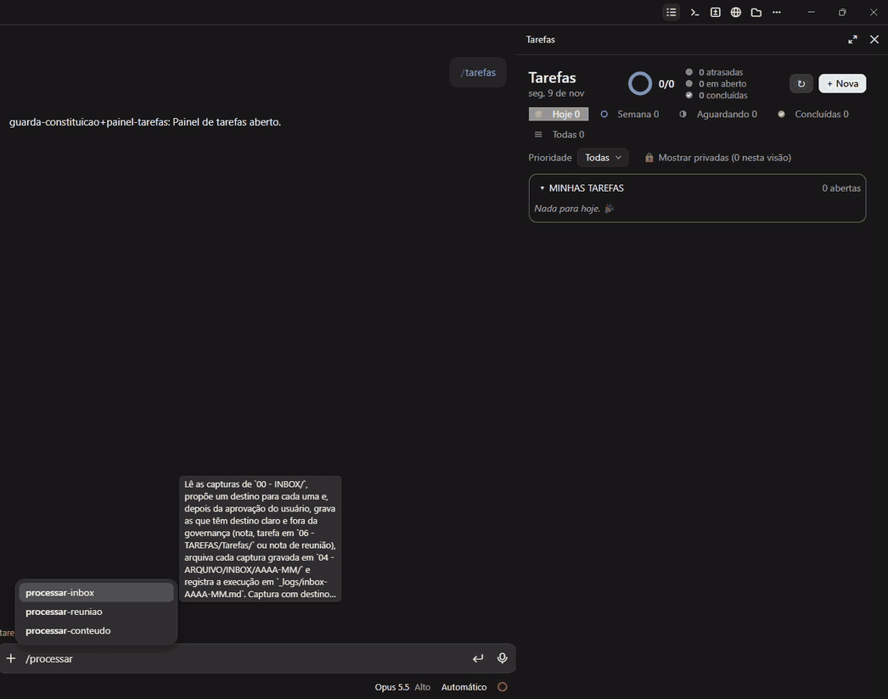
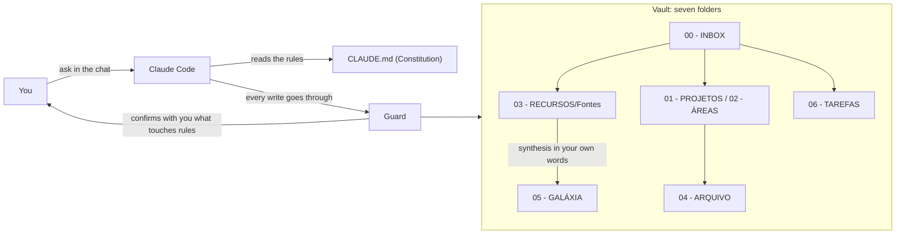

<p align="center"></p>

# Segundo Cérebro

> Stuck during installation? [Tell us here](https://github.com/filipefiorini/segundo-cerebro/issues/new?template=instalei-e-travei.yml). We reply within 48 hours.

> The framework, skills and modules speak Brazilian Portuguese; this page mirrors the Portuguese README.

[Leia em português](README.pt-BR.md)

## 🧠 What it is

**Your notes, tasks and decisions organized by Claude, on your own computer, and nothing important happens without your ok.**

Organize what you learn, decide and need to do with an AI that works on its own and asks permission for what is sensitive and for the proposal of each batch.

You ask and Claude carries it out; you approve the proposal once, not each step. It reads your captures, decides where each one goes, writes the notes, creates the tasks with due dates and answers about what the vault already records.

Oversight sits at the points where a mistake is costly. The rules are written in `CLAUDE.md`, the vault's Constitution, and the Guard (Guarda), a module that comes with it, checks every action before it happens. Changing a rule, overwriting or deleting a note and writing to a connector wait for your confirmation. A CPF (Brazilian ID number) and writes to a credentials file it always refuses.

Segundo Cérebro ("second brain") is a vault, the notes folder that Obsidian (a free notes app) opens, already organized into seven folders, with templates, tasks and a manual. Notes are Markdown files, plain text any editor can read, and they stay on your computer. The one working on them with you is Claude Code, the part of Claude Desktop that reads and writes files in a folder of yours.

The whole method fits on one page: [`_docs/O Método.md`](_docs/O%20M%C3%A9todo.md).

## ⏱️ In two minutes

1. You paste a capture (an excerpt, a link, a loose idea) into a note in `00 - INBOX`, the inbox.
2. You call `/processar-inbox`, a skill (a script Claude follows), and Claude reads the capture and proposes where it goes.
3. With your ok, the note goes to the right folder, in the template for that kind of note.
4. Anything to be done becomes a task: a note in `06 - TAREFAS`, always with a due date.
5. The task shows up in the Panel, next to the chat, where you complete it, postpone it or change its date with one click.

<p align="center"></p>

## 🛡️ What Claude can and cannot do

| Piece | Can | Cannot |
|---|---|---|
| Guard (module) | See every Claude action before it happens; ask for your confirmation on governance writes (`CLAUDE.md`, `_docs/`, `_templates/`, `.claude/`), note overwrites, actions that delete and connector writes; refuse a CPF in a note, a task without a due date, credentials and phone numbers in files read every session | Read the content of your files, write files, use the network, send messages or release what it refuses. Suspending confirmations for 1 hour (`/guarda liberar`) is yours alone |
| Panel (module, `/tarefas`) | Show the notes in `06 - TAREFAS/Tarefas/` next to the chat; on your click, change status, due date, priority and project, and create a new task without overwriting | Write outside the tasks, touch the body of a note, delete, use the network |
| claude.ai connectors (email, calendar, files) | Whatever each one's row in the Zero Trust table (the list of what each integration can and cannot do) of `CLAUDE.md` says; `/instalar` writes that row with your approval | Anything the row does not allow; connector writes always go through the Guard's confirmation |

Two examples of how this shows up in a session:

- You ask Claude to add a new rule to `CLAUDE.md`: every meeting note gets the `reuniao` tag. It shows the change in the chat. When it is time to write, the Guard holds the write and asks whether you confirm, with the file path and the summary of the change. The rule only goes in if you accept.
- You paste a client's record, with their CPF, and ask for a note. The Guard refuses the write and the note is not created with the number. Claude explains the refusal and you decide how to go on. `/guarda liberar` does not change this: it only suspends confirmations, and refusals still apply.

A connector is the link, set up by you on claude.ai, between Claude and a service of yours. When the Guard asks for confirmation, `/instalar` teaches you to read it like this:

> When the Guard asks, read two things: the file path (is it what you just approved in the chat?) and the summary of the change (does it match what I showed?). If both match, accept. Refuse if the file is a different one, if the change was not shown, or if it is anything outside what this step said it would do. Refusing breaks nothing: I stop and explain.

## 🧩 Just the Guard

If you already have a vault and only want the safety net, the Guard installs on its own, as a Claude Code plugin. Without the "Pasta do vault" (vault folder) option filled in, it stays inert.

**From the Claude Code terminal:**

```
/plugin marketplace add filipefiorini/segundo-cerebro
/plugin install guarda-constituicao@segundo-cerebro
```

Then, in `/plugin`, fill in "Pasta do vault".

**From Claude Desktop:** in Settings › Plugins › Add, enter `filipefiorini/segundo-cerebro` and install the Guard. Desktop has no field for the plugin's options, so "Pasta do vault" is filled in from PowerShell (or ask Claude, in a session, to run the command), with the backslashes doubled inside the JSON:

```powershell
'{"vault": "C:\\Users\\you\\Notes"}' | claude plugin configure guarda-constituicao@segundo-cerebro --values-stdin
```

Without `--values-stdin`, the command only lists the options and which ones are missing.

The refusals apply, and so do the confirmations for destructive commands, overwrites, connectors and the governance files you list (`CLAUDE.md` and `.claude/` always stay). To check, open a new session in the vault and run `/guarda`: it should show "Modo: avulso…" (standalone mode). The rest is in the [module's README](.claude/skills/guarda-constituicao/README.md) (in Portuguese).

## ⚙️ How it works



You ask; Claude Code reads the Constitution and proposes; the Guard, a module that checks every action against the rules, asks for your confirmation on anything that touches governance. External material becomes a Literature Note (a card for the external material) in Fontes (`03 - RECURSOS/Fontes`), and what you take from it, in your own words, becomes a Galaxy (Galáxia) note.

## 🎯 Who it is for and who it is not for

**It is for people who:**

- want to keep what they learn, decide and need to do in a place they own, as files on their own computer;
- already use Claude and want it to read and maintain their notes following written rules;
- don't program: setup is guided by `/instalar`, in a conversation with Claude;
- want the AI to do the work and stop only at the proposal and at what is sensitive;
- use Windows and read Portuguese.

**It is not for people who:**

- want a ready-made cloud or phone app, with nothing to install;
- want ready-made scheduled routines, without building anything (here you create your own with Claude);
- use macOS or Linux;
- do not have a Claude subscription that includes Claude Code.

## 🧰 What you need

- Windows.
- [Claude Desktop](https://claude.ai/download), with a subscription that includes Claude Code.
- [Obsidian](https://obsidian.md) 1.14 or newer. Just install it: the vault is opened in it when `/instalar` asks.
- 15 to 20 minutes (40 to 60 with backup).
- Only if you want backup: a free account, explained in the [Backup](#-backup) section.

You do not use the terminal. You will approve one command once: it installs the six Obsidian plugins, downloaded from their official repositories. An Obsidian plugin is an extension that adds features to the app; the full list, with authors, is in [`_docs/Configuração de Plugins/LEIA-ME.md`](_docs/Configura%C3%A7%C3%A3o%20de%20Plugins/LEIA-ME.md).

## 📥 Install

### Quick path (15 to 20 minutes)

1. **Download.** Open the [page for the latest release](https://github.com/filipefiorini/segundo-cerebro/releases/latest) and, under **Assets**, click the file that starts with segundo-cerebro-v and ends in .zip. A ZIP is a compressed file with all the folders inside.
2. **Extract.** In File Explorer, right-click the ZIP › **Extract All**. In the dialog, change the destination to a folder outside OneDrive, for example `C:\vaults` (through the **Browse** button, which can also create a new folder), and delete the `\segundo-cerebro-v…` Windows appends to the end of the path: the ZIP already contains that folder. Desktop and Documents are often inside OneDrive, whose syncing fights Obsidian and Claude over the files. The vault folder is the one that has `CLAUDE.md` directly inside it.
3. **Open it in Claude Code.** In Claude Desktop, go to the Code tab and choose that folder as the working folder.
4. **Accept folder trust.** Claude Desktop asks whether you trust it. Accepting lets the vault's two modules run, the Guard and the Panel. Only accept for a vault downloaded from a source you know.
5. **Call `/instalar`.** The assistant talks with you, one question at a time: it installs the Obsidian plugins (you approve the command), asks you to open the folder in Obsidian, gets to know you, creates your areas and projects, brings in your projects from other AIs and, if you want, sets up connectors and backup. Nothing is written without your ok, and you can stop and resume later by calling `/instalar` again.

The vault comes with example notes in the Galaxy and in Fontes. They are optional: at the end of `/instalar`, you choose to keep them or start without them.

### Full path, with backup (40 to 60 minutes)

For people who want backup from the start. Here the vault comes as a clone, a copy of the repository linked to its origin.

1. Install [GitHub Desktop](https://desktop.github.com) and [Git for Windows](https://git-scm.com/download/win), which the backup uses (in the installer, click Next until Install).
2. On this page, green **Code** button › **Open with GitHub Desktop**. Pick a folder of yours, outside OneDrive, and click **Clone**.
3. Follow steps 3 to 5 of the quick path. At the end, `/instalar` walks you through the backup, window by window, and swaps the link to this repository for a private repository of yours.

## 🗂️ The folders

The vault has seven folders: six for content and one for tasks. Each folder answers one question. Everything enters through the INBOX. To give a note a destination, ask the questions of the other folders, from top to bottom, and stop at the first yes; if none is a yes, the note waits in the INBOX.

| Folder | Question |
|---|---|
| `00 - INBOX` | Do I need to keep this right now? |
| `01 - PROJETOS` | Does it have a defined deliverable? |
| `02 - ÁREAS` | Is it something I keep up all the time? |
| `03 - RECURSOS` | Will I reuse it in several contexts? |
| `04 - ARQUIVO` | Is it finished or no longer valid? |
| `05 - GALÁXIA` | Is it a timeless insight of mine? |
| `06 - TAREFAS` | Is it something to do? |

What decides the folder is how the note will be used, not its subject.

## 🌌 The Galaxy

The Galaxy (Galáxia) holds permanent knowledge, written in your own words, in five layers that go from abstract to concrete: Filosofias (philosophies), Conceitos (concepts), Frameworks, Metodologias (methodologies) and Táticas (tactics). Each layer answers one question. The layer is a property of the note, not a folder: everything stays in `05 - GALÁXIA`, with one view per layer.

If a note answers more than one question, it goes in the layer of the question you would ask to find it again. Before taking an idea there: "would I look for this outside any project?". Claude offers candidates at the end of a session, meeting or deliberation, and never writes them without your approval.

The questions of each layer, with examples, are in [`_docs/O Método.md`](_docs/O%20M%C3%A9todo.md).

## 💾 Backup

Backup is optional and keeps a copy of the vault in a private repository of yours on GitHub, sent by Obsidian's Git plugin every 30 minutes while Obsidian is open. Until you set it up, nothing leaves your computer: automatic sending ships turned off. The step by step, with windows, is in the [backup step of `/instalar`](.claude/skills/instalar/reference.md#etapa-8--backup), which asks for Git for Windows and a free GitHub account.

## 🛠️ Customization

Something missing? Ask Claude: a new area, a template, a skill, a module. Point it to [`_docs/O Método.md`](_docs/O%20M%C3%A9todo.md), the [Manual](_docs/Manual%20do%20Segundo%20C%C3%A9rebro.md) and [Ferramentas](_docs/Ferramentas.md) (tools): they are the manual it reads to do things the vault's way.

Change the defaults without fear. The framework was made to be changed: folders, templates, rules and the Constitution itself are yours. The Guard asks for confirmation when you touch rules; it does not forbid.

Share back through an issue (a report on the repository) or a pull request (a proposed change), including what did not work. To work on the framework itself, see [`CONTRIBUTING.md`](CONTRIBUTING.md).

## 🚧 Status and limits

- Version `1.0.0`.
- Windows only.
- Portuguese only.
- Updates go through `/atualizar`: Claude downloads the zip of the new version from the repository's releases page by itself (pointing it to a zip you already downloaded still works); it checks the hashes, shows the plan file by file and only applies it with your approval, after a backup. Do not update with `git pull`.
- This version ships no scheduled routines: Claude works when you open a session, and you can freely create your own, with its help. How the author runs routines at home is in [`_docs/Como o Autor Opera em Casa.md`](_docs/Como%20o%20Autor%20Opera%20em%20Casa.md), as an idea, not as an installation.
- No semantic search (search by the meaning of words): search is by text, tags and links.

## ⚖️ Compared with

| Alternative | Does better | What is different here |
|---|---|---|
| claude.ai Projects | Nothing to install; works in the browser and on the phone; instructions and files in one place | Notes are files on your computer, in folders with a filing rule, and Claude writes to them with your approval |
| Plain Obsidian | Simpler, no AI subscription, on any system | Comes with structure, templates, tasks with due dates and an agent that follows written rules |
| claude-obsidian | Turns sources into a linked wiki; transactional writes, with a log to undo and conflict warnings; installs as a Claude Code plugin | Covers the whole vault (projects, areas, tasks), with written permissions per integration and the Guard; writes on Windows without a Linux layer |
| obsidian-second-brain | Dozens of ready-made operations, several agents on the same vault, scheduled agents, ready-made profiles | A single agent, in the session, with nothing running in the background; every write goes through the rules and the Guard |
| vault-operator | Approval of each write, a permissions center and undo | Permissions written as text in `CLAUDE.md`, one row per integration, enforced by the Guard; the framework has no undo of its own, backup is the way back |

## 📖 Glossary

- **Vault:** the notes folder Obsidian opens. Here, this project's whole folder.
- **Obsidian:** free notes app that reads and shows Markdown files from a folder on your computer.
- **Claude Code:** the part of Claude Desktop that works in a folder of yours, reading and writing files with your approval.
- **Obsidian plugin:** extension that adds features to Obsidian (tasks, templates, Homepage).
- **Claude plugin:** extension installed in the Claude app that brings new skills or tools.
- **Module:** Claude Code extension that ships with the vault, in `.claude/skills/`. There are two: Guard and Panel.
- **Skill:** script Claude follows when you call a name with a slash, such as `/instalar` or `/processar-inbox`.
- **Connector:** link between Claude and a service of yours (email, calendar, files), set up on claude.ai.
- **Frontmatter:** the block at the top of each note with fields such as `tipo`, `status` and `due`.
- **Wikilink:** link between notes in the form `[[Note name]]`.
- **Repository:** a project's folder kept with version history, for example on GitHub.
- **Clone:** copy of a repository that stays linked to its origin, made with Git or GitHub Desktop.
- **ZIP:** compressed file; downloading the ZIP brings the folders with no history and no link to the origin.
- **Backup:** copy of the vault in a private repository of yours on GitHub, sent by the Git plugin.
- **Guard (Guarda):** module that checks every Claude action against the rules, asks for confirmation or refuses.
- **Panel (Painel):** module that shows your tasks next to the chat (`/tarefas`).
- **IPARAG:** the seven folders of the vault. The acronym comes from the six content folders (INBOX, Projetos, Áreas, Recursos, Arquivo, Galáxia); the seventh holds tasks.
- **Galaxy (Galáxia):** the `05 - GALÁXIA` folder, with permanent knowledge written in your own words.
- **Layer:** each of the Galaxy's five levels (Filosofias, Conceitos, Frameworks, Metodologias, Táticas).
- **Literature Note (Nota de Literatura):** card for an external source (book, article, video), kept in `03 - RECURSOS/Fontes`.
- **Zero Trust:** table in `CLAUDE.md` listing what each integration can and cannot do.
- **INBOX:** the inbox; everything that arrives and does not have a place yet.
- **Area:** ongoing responsibility, with no end date (health, work, home).
- **Project:** work with a deliverable and a definition of done.

## 🙏 Credits

The IPARAG folder structure and the Galaxy come from the LIFE OS Vault by Noah's Ark Bank (Noah Vincent), translated and extended here with the tasks folder, the layers and the Constitution. The five layers were inspired by the DNA Schema of Mega Brain (Thiago Finch) and redefined in this project. The capture and synthesis method comes from *Building a Second Brain* and PARA, by Tiago Forte.

- The theme is Dracula Official, under the MIT license.
- The banners were generated with an AI tool.
- The vault uses 19 Obsidian community plugins (6 required, installed by `/instalar`, and 13 optional), each by its own authors, listed with links in [`_docs/Configuração de Plugins/LEIA-ME.md`](_docs/Configura%C3%A7%C3%A3o%20de%20Plugins/LEIA-ME.md).

## 📜 Licenses

- Code: MIT ([`LICENSE`](LICENSE)).
- Text: CC BY 4.0 ([`LICENSE-CONTEUDO`](LICENSE-CONTEUDO)).
