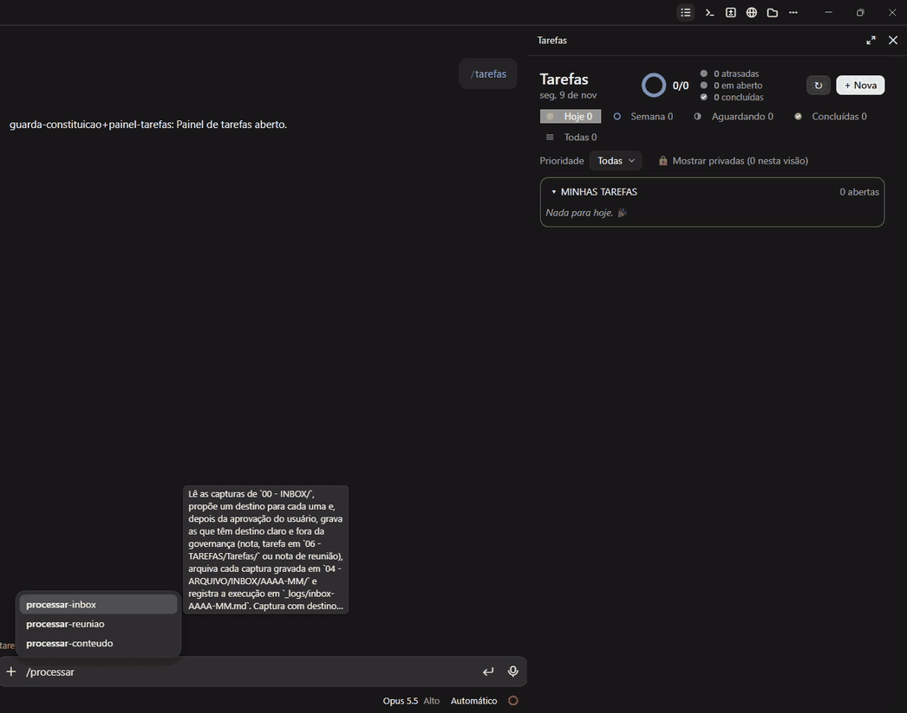
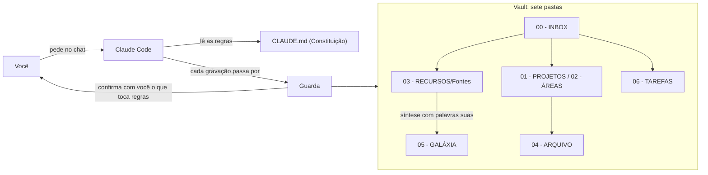

<p align="center"></p>

# Segundo Cérebro

> Travou na instalação? [Conte aqui](https://github.com/filipefiorini/segundo-cerebro/issues/new?template=instalei-e-travei.yml). A resposta sai em até 48 horas.

[Read in English](README.md)

## 🧠 O que é

**Suas notas, tarefas e decisões organizadas pelo Claude, no seu computador, e nada importante acontece sem o seu ok.**

Organize o que você aprende, decide e precisa fazer com uma IA que trabalha por conta própria e pede licença no que é sensível e na proposta de cada lote.

Você pede e o Claude executa; você aprova a proposta de uma vez, não cada passo. Ele lê suas capturas, decide o destino de cada uma, grava as notas, cria as tarefas com prazo e responde sobre o que o vault já registra.

A supervisão fica nos pontos em que um erro custa caro. As regras estão escritas no `CLAUDE.md`, a Constituição do vault, e a Guarda, um módulo que vem junto, confere cada ação antes de ela acontecer. Mudar uma regra, sobrescrever ou apagar uma nota e escrever num conector esperam a sua confirmação. CPF e escrita em arquivo de credencial ela recusa sempre.

O Segundo Cérebro é um vault, a pasta de notas que o Obsidian (um app de notas gratuito) abre, já organizado em sete pastas, com templates, tarefas e um manual. As notas são arquivos Markdown, texto simples que qualquer editor lê, e ficam no seu computador. Quem trabalha nelas com você é o Claude Code, a parte do Claude Desktop que lê e grava arquivos numa pasta sua.

O método inteiro cabe numa página: [`_docs/O Método.md`](_docs/O%20M%C3%A9todo.md).

## ⏱️ Em dois minutos

1. Você cola uma captura (um trecho, um link, uma ideia solta) numa nota em `00 - INBOX`, a caixa de entrada.
2. Você chama `/processar-inbox`, uma skill (roteiro que o Claude segue), e o Claude lê a captura e propõe o destino.
3. Com o seu ok, a nota vai para a pasta certa, no formato do template daquele tipo de nota.
4. O que for para fazer vira tarefa: uma nota em `06 - TAREFAS`, sempre com prazo.
5. A tarefa aparece no Painel, ao lado do chat, onde você conclui, adia ou muda o prazo com um clique.

<p align="center"></p>

## 🛡️ O que o Claude pode e não pode

| Peça | Pode | Não pode |
|---|---|---|
| Guarda (módulo) | Ver cada ação do Claude antes de ela acontecer; pedir a sua confirmação em escrita de governança (`CLAUDE.md`, `_docs/`, `_templates/`, `.claude/`), em sobrescrita de nota, em ação que apaga e em escrita em conector; recusar CPF em nota, tarefa sem prazo, credencial e telefone em arquivo lido em toda sessão | Ler o conteúdo dos seus arquivos, gravar arquivo, acessar a rede, enviar mensagem ou liberar o que ela recusa. Suspender as confirmações por 1 hora (`/guarda liberar`) é só seu |
| Painel (módulo, `/tarefas`) | Mostrar as notas de `06 - TAREFAS/Tarefas/` ao lado do chat; por clique seu, mudar status, prazo, prioridade e projeto, e criar tarefa nova sem sobrescrever | Gravar fora das tarefas, mexer no corpo da nota, apagar, acessar a rede |
| Conectores do claude.ai (e-mail, agenda, arquivos) | O que a linha de cada um na tabela Zero Trust (a lista do que cada integração pode e não pode) do `CLAUDE.md` disser; o `/instalar` grava essa linha com a sua aprovação | Tudo o que a linha não liberar; escrita em conector sempre passa pela confirmação da Guarda |

Dois exemplos de como isso aparece numa sessão:

- Você pede ao Claude que acrescente ao `CLAUDE.md` uma regra nova: toda nota de reunião leva a tag `reuniao`. Ele mostra a mudança no chat. Na hora de gravar, a Guarda segura a escrita e pergunta se você confirma, com o caminho do arquivo e o resumo da mudança. A regra só entra se você aceitar.
- Você cola a ficha de um cliente, com o CPF dele, e pede uma nota. A Guarda recusa a gravação e a nota não é criada com o número. O Claude explica a recusa e você decide como seguir. O `/guarda liberar` não muda isso: ele suspende só as confirmações, e as recusas continuam valendo.

Conector é a ligação, feita por você no claude.ai, entre o Claude e um serviço seu. Quando a Guarda pedir confirmação, o `/instalar` ensina a ler assim:

> Quando a Guarda perguntar, leia duas coisas: o caminho do arquivo (é o que você acabou de aprovar no chat?) e o resumo da mudança (bate com o que eu mostrei?). Se as duas baterem, aceite. Recuse se o arquivo for outro, se a mudança não tiver sido mostrada, ou se for algo fora do que esta etapa disse que faria. Recusar não quebra nada: eu paro e explico.

## 🧩 Só a Guarda

Para quem já tem um vault e quer só a rede de segurança: a Guarda instala sozinha, como plugin do Claude Code. Sem a opção "Pasta do vault" preenchida, ela fica inerte.

**Pelo terminal do Claude Code:**

```
/plugin marketplace add filipefiorini/segundo-cerebro
/plugin install guarda-constituicao@segundo-cerebro
```

Depois, em `/plugin`, preencha a "Pasta do vault".

**Pelo Claude Desktop:** em Configurações › Plugins › Adicionar, informe `filipefiorini/segundo-cerebro` e instale a Guarda. O Desktop não tem campo para as opções do plugin, então a "Pasta do vault" se preenche no PowerShell (ou peça ao Claude, numa sessão, que rode o comando), com as barras invertidas dobradas dentro do JSON:

```powershell
'{"vault": "C:\\Users\\voce\\Notas"}' | claude plugin configure guarda-constituicao@segundo-cerebro --values-stdin
```

Sem o `--values-stdin`, o comando só lista as opções e quais faltam.

Valem as recusas e as confirmações de comando destrutivo, sobrescrita, conector e dos arquivos de governança que você listar (`CLAUDE.md` e `.claude/` ficam sempre). Para conferir, abra uma sessão nova no vault e rode `/guarda`: deve aparecer "Modo: avulso…". O resto está no [README do módulo](.claude/skills/guarda-constituicao/README.md).

## ⚙️ Como funciona



Você pede, o Claude Code lê a Constituição e propõe; a Guarda, um módulo que confere cada ação contra as regras, pede a sua confirmação no que mexe em governança. Material externo vira Nota de Literatura (ficha do material externo) em Fontes (`03 - RECURSOS/Fontes`), e o que você extrai dele, com palavras suas, vira nota da Galáxia.

## 🎯 Para quem é e para quem não é

**É para quem:**

- quer guardar o que aprende, decide e precisa fazer num lugar que é seu, em arquivos no próprio computador;
- já usa o Claude e quer que ele leia e mantenha as notas seguindo regras escritas;
- não programa: a configuração é guiada pelo `/instalar`, numa conversa com o Claude;
- quer que a IA faça o trabalho e pare só na proposta e no que é sensível;
- usa Windows e lê português.

**Não é para quem:**

- quer um app pronto na nuvem ou no celular, sem instalar nada;
- quer rotinas agendadas prontas, sem montar nada (aqui você cria as suas com o Claude);
- usa macOS ou Linux;
- não tem assinatura do Claude que inclua o Claude Code.

## 🧰 O que você precisa

- Windows.
- [Claude Desktop](https://claude.ai/download), com uma assinatura que inclua o Claude Code.
- [Obsidian](https://obsidian.md) 1.14 ou mais novo. Só instale: o vault é aberto nele quando o `/instalar` pedir.
- De 15 a 20 minutos (40 a 60 com backup).
- Só se quiser backup: uma conta gratuita, explicada na seção [Backup](#-backup).

Você não usa o terminal. Você vai aprovar um comando uma vez: ele instala os seis plugins do Obsidian, baixados dos repositórios oficiais. Plugin do Obsidian é uma extensão que acrescenta funções ao app; a lista completa, com autores, está em [`_docs/Configuração de Plugins/LEIA-ME.md`](_docs/Configura%C3%A7%C3%A3o%20de%20Plugins/LEIA-ME.md).

## 📥 Instalar

### Caminho rápido (15 a 20 minutos)

1. **Baixe.** Abra a [página da última versão](https://github.com/filipefiorini/segundo-cerebro/releases/latest) e, em **Assets**, clique no arquivo que começa com segundo-cerebro-v e termina em .zip. ZIP é um arquivo compactado com todas as pastas dentro.
2. **Extraia.** No Explorador de Arquivos, clique com o botão direito no ZIP › **Extrair tudo**. Na janela, troque o destino por uma pasta fora do OneDrive, por exemplo `C:\vaults` (pelo botão **Procurar**, que também cria pasta nova), e apague do fim do caminho o `\segundo-cerebro-v…` que o Windows acrescenta: o ZIP já traz essa pasta. Área de Trabalho e Documentos costumam ficar no OneDrive, cuja sincronização disputa os arquivos com o Obsidian e o Claude. A pasta do vault é a que tem o `CLAUDE.md` logo dentro dela.
3. **Abra no Claude Code.** No Claude Desktop, entre na aba Code e escolha essa pasta como pasta de trabalho.
4. **Aceite a confiança da pasta.** O Claude Desktop pergunta se você confia nela. Aceitar deixa rodar os dois módulos do vault, a Guarda e o Painel. Só aceite num vault baixado de fonte que você conhece.
5. **Chame `/instalar`.** O assistente conversa com você, uma pergunta por vez: instala os plugins do Obsidian (você aprova o comando), pede que você abra a pasta no Obsidian, conhece você, cria suas áreas e projetos, traz seus projetos de outras IAs e, se você quiser, liga conectores e o backup. Nada é gravado sem o seu ok, e dá para parar e continuar depois chamando `/instalar` de novo.

O vault vem com notas de exemplo na Galáxia e nas Fontes. Elas são opcionais: no fim do `/instalar`, você escolhe ficar com elas ou começar sem elas.

### Caminho completo, com backup (40 a 60 minutos)

Para quem quer o backup desde o início. Aqui o vault vem por clone, uma cópia do repositório ligada à origem.

1. Instale o [GitHub Desktop](https://desktop.github.com) e o [Git para Windows](https://git-scm.com/download/win), que o backup usa (no instalador, vá em Next até Install).
2. Nesta página, botão verde **Code** › **Open with GitHub Desktop**. Escolha uma pasta sua, fora do OneDrive, e clique em **Clone**.
3. Siga os passos 3 a 5 do caminho rápido. No fim, o `/instalar` conduz o backup, janela por janela, e troca a ligação com este repositório por um repositório privado seu.

## 🗂️ As pastas

O vault tem sete pastas: seis de conteúdo e uma de tarefas. Cada pasta responde a uma pergunta. Tudo entra pelo INBOX. Para dar destino a uma nota, faça as perguntas das outras pastas, de cima para baixo, e pare na primeira que for sim; se nenhuma for, ela espera no INBOX.

| Pasta | Pergunta |
|---|---|
| `00 - INBOX` | Preciso guardar isso agora? |
| `01 - PROJETOS` | Tem entregável definido? |
| `02 - ÁREAS` | É algo que mantenho sempre? |
| `03 - RECURSOS` | Vou reusar em vários contextos? |
| `04 - ARQUIVO` | Acabou ou perdeu validade? |
| `05 - GALÁXIA` | É um insight atemporal meu? |
| `06 - TAREFAS` | É algo a fazer? |

O que decide a pasta é o uso que a nota vai ter, não o assunto dela.

## 🌌 A Galáxia

A Galáxia guarda o conhecimento permanente, escrito com palavras suas, em cinco camadas que vão do abstrato ao concreto: Filosofias, Conceitos, Frameworks, Metodologias e Táticas. Cada camada responde a uma pergunta. A camada é uma propriedade da nota, não uma pasta: tudo fica em `05 - GALÁXIA`, com uma vista por camada.

Se a nota responde a mais de uma pergunta, fica na camada da pergunta que você faria para reencontrá-la. Antes de levar uma ideia para lá: "eu buscaria isto fora de qualquer projeto?". O Claude oferece candidatas no fim de uma sessão, reunião ou deliberação, e nunca grava sem a sua aprovação.

As perguntas de cada camada, com exemplos, estão em [`_docs/O Método.md`](_docs/O%20M%C3%A9todo.md).

## 💾 Backup

O backup é opcional e guarda uma cópia do vault num repositório privado seu no GitHub, enviada pelo plugin Git do Obsidian a cada 30 minutos, com o Obsidian aberto. Até você configurar, nada sai do seu computador: o envio automático vem desligado. O passo a passo, com janelas, está na [etapa de backup do `/instalar`](.claude/skills/instalar/reference.md#etapa-8--backup), que pede o Git para Windows e uma conta gratuita no GitHub.

## 🛠️ Personalização

Falta alguma coisa? Peça ao Claude: uma área nova, um template, uma skill, um módulo. Aponte para [`_docs/O Método.md`](_docs/O%20M%C3%A9todo.md), o [Manual](_docs/Manual%20do%20Segundo%20C%C3%A9rebro.md) e as [Ferramentas](_docs/Ferramentas.md): são o manual que ele lê para fazer do jeito do vault.

Mude o padrão sem medo. O framework foi feito para ser mudado: pastas, templates, regras e a própria Constituição são seus. A Guarda pede confirmação quando você mexe em regras; ela não proíbe.

Compartilhe de volta por issue (um relato no repositório) ou pull request (uma proposta de mudança), inclusive o que não deu certo. Para mexer no próprio framework, veja [`CONTRIBUTING.md`](CONTRIBUTING.md).

## 🚧 Estado e limites

- Versão `1.0.0`.
- Só Windows.
- Só português.
- A atualização é pelo `/atualizar`: o Claude baixa sozinho o zip da versão nova na página de releases do repositório (indicar um zip que você já baixou continua valendo), confere os hashes, mostra o plano arquivo por arquivo e só aplica com a sua aprovação, depois de um backup. Não atualize por `git pull`.
- Esta versão não traz rotinas agendadas: o Claude trabalha quando você abre uma sessão, e você pode criar as suas livremente, com a ajuda dele. Como o autor roda rotinas em casa está em [`_docs/Como o Autor Opera em Casa.md`](_docs/Como%20o%20Autor%20Opera%20em%20Casa.md), como ideia, não como instalação.
- Sem busca semântica (busca pelo sentido das palavras): a busca é por texto, tags e links.

## ⚖️ Comparado com

| Alternativa | Faz melhor | Aqui é diferente |
|---|---|---|
| Projects do claude.ai | Nada a instalar; funciona no navegador e no celular; instruções e arquivos num lugar só | As notas são arquivos no seu computador, em pastas com regra de destino, e o Claude grava nelas com a sua aprovação |
| Obsidian puro | Mais simples, sem assinatura de IA, em qualquer sistema | Vem com estrutura, templates, tarefas com prazo e um agente que segue regras escritas |
| claude-obsidian | Transforma fontes num wiki ligado; escrita em transação, com registro para desfazer e aviso de conflito; instala como plugin do Claude Code | Cobre o vault inteiro (projetos, áreas, tarefas), com permissões escritas por integração e a Guarda; escreve no Windows sem camada Linux |
| obsidian-second-brain | Dezenas de operações prontas, vários agentes no mesmo vault, agentes agendados, perfis prontos | Um agente só, na sessão, sem nada rodando em segundo plano; cada gravação passa pelas regras e pela Guarda |
| vault-operator | Aprovação de cada escrita, central de permissões e desfazer | Permissões escritas em texto, no `CLAUDE.md`, uma linha por integração, com a Guarda fazendo valer; o framework não traz desfazer próprio, o backup é o caminho de volta |

## 📖 Glossário

- **Vault:** a pasta de notas que o Obsidian abre. Aqui, a pasta inteira deste projeto.
- **Obsidian:** app de notas gratuito que lê e mostra arquivos Markdown de uma pasta do seu computador.
- **Claude Code:** a parte do Claude Desktop que trabalha numa pasta sua, lendo e gravando arquivos com a sua aprovação.
- **Plugin do Obsidian:** extensão que acrescenta funções ao Obsidian (tarefas, templates, Homepage).
- **Plugin do Claude:** extensão instalada no app do Claude que traz skills ou ferramentas novas.
- **Módulo:** extensão do Claude Code que vem no vault, em `.claude/skills/`. São dois: Guarda e Painel.
- **Skill:** roteiro que o Claude segue quando você chama um nome com barra, como `/instalar` ou `/processar-inbox`.
- **Conector:** ligação entre o Claude e um serviço seu (e-mail, agenda, arquivos), feita no claude.ai.
- **Frontmatter:** o bloco no topo de cada nota com campos como `tipo`, `status` e `due`.
- **Wikilink:** link entre notas no formato `[[Nome da nota]]`.
- **Repositório:** pasta de um projeto guardada com histórico de versões, por exemplo no GitHub.
- **Clone:** cópia de um repositório que continua ligada à origem, feita com Git ou GitHub Desktop.
- **ZIP:** arquivo compactado; baixar o ZIP traz as pastas sem histórico nem ligação com a origem.
- **Backup:** cópia do vault num repositório privado seu no GitHub, enviada pelo plugin Git.
- **Guarda:** módulo que confere cada ação do Claude contra as regras, pede confirmação ou recusa.
- **Painel:** módulo que mostra suas tarefas ao lado do chat (`/tarefas`).
- **IPARAG:** as sete pastas do vault. A sigla vem das seis de conteúdo (INBOX, Projetos, Áreas, Recursos, Arquivo, Galáxia); a sétima é das tarefas.
- **Galáxia:** a pasta `05 - GALÁXIA`, com o conhecimento permanente escrito com palavras suas.
- **Camada:** cada um dos cinco níveis da Galáxia (Filosofias, Conceitos, Frameworks, Metodologias, Táticas).
- **Nota de Literatura:** ficha de um material externo (livro, artigo, vídeo), guardada em `03 - RECURSOS/Fontes`.
- **Zero Trust:** tabela do `CLAUDE.md` com o que cada integração pode e não pode fazer.
- **INBOX:** a caixa de entrada; tudo que chega e ainda não tem destino.
- **Área:** responsabilidade contínua, sem data para acabar (saúde, trabalho, casa).
- **Projeto:** trabalho com entrega e critério de pronto.

## 🙏 Créditos

A estrutura de pastas IPARAG e a Galáxia vêm do LIFE OS Vault do Noah's Ark Bank (Noah Vincent), traduzidas e estendidas aqui com a pasta de tarefas, as camadas e a Constituição. As cinco camadas foram inspiradas no DNA Schema do Mega Brain (Thiago Finch) e redefinidas neste projeto. O método de captura e síntese vem de *Building a Second Brain* e do PARA, de Tiago Forte.

- O tema é o Dracula Official, sob licença MIT.
- Os banners foram gerados com ferramenta de IA.
- O vault usa 19 plugins da comunidade do Obsidian (6 obrigatórios, instalados pelo `/instalar`, e 13 opcionais), cada um de seus autores, listados com link em [`_docs/Configuração de Plugins/LEIA-ME.md`](_docs/Configura%C3%A7%C3%A3o%20de%20Plugins/LEIA-ME.md).

## 📜 Licenças

- Código: MIT ([`LICENSE`](LICENSE)).
- Texto: CC BY 4.0 ([`LICENSE-CONTEUDO`](LICENSE-CONTEUDO)).
