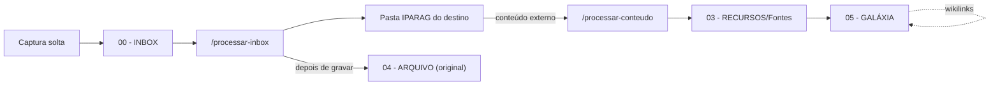

![[_assets/banner-segundo-cerebro.png]]

# 🧭 O Método

> [!info] Uma página só
> O método do Segundo Cérebro em cinco partes: a ideia, as sete pastas, a Galáxia, o caminho de uma nota e o que o Claude faz e não faz. O detalhe de cada parte está no [[_docs/Manual do Segundo Cérebro|Manual]].

---

## 💡 Uma ideia

Organize pelo uso que a nota terá daqui para a frente, e não pelo assunto dela. Uma nota sobre finanças pode ser tarefa, projeto ou insight permanente: o que decide a pasta é o que você vai fazer com ela. Ver *Organize pelo que vai fazer, não pelo assunto*.

O segundo princípio vale para o operador de IA: o agente só faz o que está escrito. Regra que não está no `CLAUDE.md` não existe para ele. Ver *O agente só faz o que está escrito*.

---

## 🗂️ As sete pastas (IPARAG)

IPARAG: as sete pastas do vault. A sigla vem das seis de conteúdo (INBOX, Projetos, Áreas, Recursos, Arquivo, Galáxia); a sétima é das tarefas. Nenhum arquivo mora em duas pastas. Tudo entra pelo INBOX; para dar destino a uma nota, faça as perguntas das outras pastas, de cima para baixo, e pare na primeira que for sim.

| Pasta | Pergunta de roteamento |
|---|---|
| **00 - INBOX** | *"Preciso guardar isso agora?"* |
| **01 - PROJETOS** | *"Tem entregável definido?"* |
| **02 - ÁREAS** | *"É algo que mantenho sempre?"* |
| **03 - RECURSOS** | *"Vou reusar em vários contextos?"* |
| **04 - ARQUIVO** | *"Acabou ou perdeu validade?"* |
| **05 - GALÁXIA** | *"É um insight atemporal meu?"* |
| **06 - TAREFAS** | *"É algo a fazer?"* |

---

## 🌌 A Galáxia

Conhecimento permanente, escrito com palavras suas, em cinco camadas. Vão do abstrato ao concreto, e cada uma responde a uma pergunta.

| Camada | Pergunta | Exemplo |
|---|---|---|
| Filosofias | No que eu acredito? | *O cérebro é para ter ideias, não para guardá-las* |
| Conceitos | Que nome dou a isto? | *Pacotes Intermediários — nada do que você cria precisa ser descartado* |
| Frameworks | Quais são as partes e como se ligam? | *Lethal Trifecta — Framework de Segurança para Agentes de IA* |
| Metodologias | Em que ordem eu faço? | *Sumarização Progressiva — ler em camadas* |
| Táticas | O que faço nesta situação? | *Toda tarefa nasce com prazo* |

Se a nota responde a mais de uma pergunta, recebe a camada da pergunta que você faria para reencontrá-la. Uma nota, uma camada; as outras viram tags.

Antes de levar uma ideia para lá, uma pergunta: *"Eu buscaria isso de forma independente, fora de qualquer projeto?"* Se não, ela fica no contexto de origem.

---

## 🛤️ O caminho de uma nota

Tudo entra pelo INBOX. O Claude lê a captura e grava no destino certo; material externo ganha uma Nota de Literatura em Fontes, e o que você extraiu dele, em palavras suas, vira nota da Galáxia.

O original da captura vai para `04 - ARQUIVO/INBOX/` depois de gravado, com a sua confirmação. Transcrição bruta nunca entra em Fontes.

---

## 🛡️ O que o Claude faz e não faz

- **Constituição:** a cada sessão ele lê o `CLAUDE.md` e segue as regras de lá; em conflito ou dúvida de destino, pergunta antes de gravar.
- **Zero Trust:** cada integração tem um escopo escrito (o que pode, o que não pode); fora dele, ele confirma antes.
- **Guarda:** um módulo confere cada ação contra as regras: pede confirmação em governança, sobrescrita e comando destrutivo, e recusa CPF em nota. Leia o que ela mostra antes de aceitar.
- **Confirmação:** mover, arquivar, renomear, apagar ou enviar só acontece com o seu sim, e ele lê o resultado antes de dizer que terminou.
- **Sensível:** saúde, finanças pessoais, jurídico, família e credenciais não entram nos arquivos lidos em toda sessão.

---

Para o detalhe de cada parte, siga para o [[_docs/Manual do Segundo Cérebro|Manual]]; skills, templates e módulos estão em [[_docs/Ferramentas|Ferramentas]].
